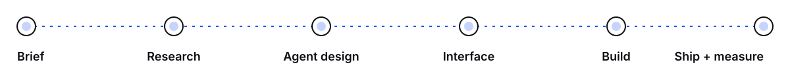

<a href="https://linkedin.com/in/kamigorosh1">
  <picture>
    <source media="(prefers-color-scheme: dark)" srcset="assets/hero-dark.svg">
    
  </picture>
</a>

  
  
  
  
  

 

## Hey, I'm Mriganka 👋

I'm an **AI engineer who designs**. I fine-tune small language models, build the agents on top of them, and design the products people use them through.

Right now I'm shipping **AI accelerators for enterprise teams**: multi-agent workflows, copilots, voice AI, AI for security, and the consoles and dashboards that make them usable. I also wrote *Thinking Like a Product Engineer*, a field guide to building useful things in the age of AI.

 

<picture>
  <source media="(prefers-color-scheme: dark)" srcset="assets/pillars-dark.svg">
  
</picture>

## How I work

<picture>
  <source media="(prefers-color-scheme: dark)" srcset="assets/process-dark.svg">
  
</picture>

One person, one loop, no handoff gaps. I design the agent and the interface together, build them in the same stack, and measure what ships.

## Right now

| | |
|:--|:--|
| 🧪 **Small language models** | Building and fine-tuning SLMs for fast, private, low-cost inference on edge and on-prem |
| 🎛️ **LoRA / QLoRA** | Parameter-efficient fine-tuning, adapters per task or client, merged and quantized for deployment |
| ⚗️ **Distillation + evals** | Distilling big-model behaviour into small models, with eval suites that prove it holds |
| 🤖 **Agent systems** | Orchestration, tool use, RAG and evals for multi-agent enterprise workflows |
| 🛡️ **AI in security** | Autonomous pentesting agents, AI-driven SOC triage and threat detection, and securing LLM apps against prompt injection |
| 🎙️ **Voice AI** | Multilingual, code-switching voice agents and the interfaces around them |
| 🧠 **Agentic UX** | Making AI that acts on its own feel understandable, trustworthy and calm |
| 🧩 **Design systems** | One source of truth across product, site, decks and docs |
| 🔭 **Open source** | Contributed to [PentAGI](https://github.com/vxcontrol/pentagi) and [Rapida Voice AI](https://github.com/rapidaai/voice-ai) |

## Toolkit

  
  &nbsp;&nbsp;&nbsp;
  
    
  

  
  
  
  
  
  
  
  
  
  
  

<b>📊 GitHub at a glance</b>

 

  <picture>
    <source media="(prefers-color-scheme: dark)" srcset="https://github-readme-stats-eight-theta.vercel.app/api?username=mrigankad&show_icons=true&hide_border=true&theme=transparent&title_color=6E8BFF&icon_color=6E8BFF&text_color=9AA3B2&count_private=true">
    
  </picture>
  <picture>
    <source media="(prefers-color-scheme: dark)" srcset="https://github-readme-stats-eight-theta.vercel.app/api/top-langs?username=mrigankad&layout=compact&hide_border=true&theme=transparent&title_color=6E8BFF&text_color=9AA3B2&langs_count=8">
    
  </picture>

 

<a href="https://linkedin.com/in/kamigorosh1">
  <picture>
    <source media="(prefers-color-scheme: dark)" srcset="assets/footer-dark.svg">
    
  </picture>
</a>
